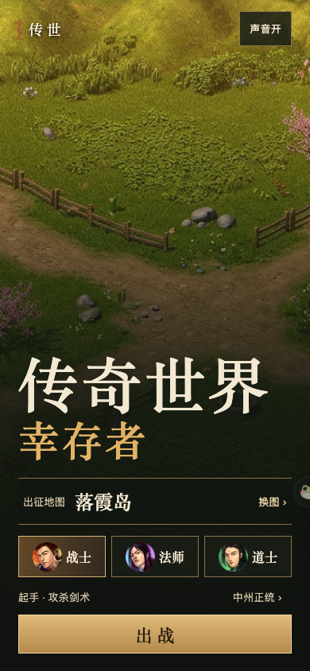

# 传奇世界幸存者 · 移动版

手机竖屏网页游戏。选择战士、法师或道士，在战场任意位置拖动移动，靠近掉落物拾取，自动释放技能。每次升级从三个选项中选择技能或被动。每局第 10 分钟出现章节首领，击败首领获胜。

## 运行

使用 Node.js 22.12 或更高版本。

```sh
npm ci
npm run dev
```

电脑访问 http://127.0.0.1:5196/ 。要在同一 Wi-Fi 下用手机试玩，运行 `npm run dev -- --host 0.0.0.0` 并打开终端显示的局域网地址。桌面也支持 WASD 和方向键。

```sh
npm test
npm run build
npm run preview
```

## 内容与实现

- 战场用草地、石板、沙土、泥地、冰雪和玄武岩拼铺。树干、围栏与建筑底座会挡住角色和怪物，绕到高大物件背后时，遮挡主角的物件会淡出。手机竖屏采用 75% 战场缩放。
- 战士以攻杀剑术近战，法师以火球术远攻，道士以灵魂火符配骷髅起手。底栏显示气血、经验和各技能冷却。
- 落霞岛、中州平原、热砂荒漠、死水沼泽、玄冰雪原、铁血魔渊有各自的地图画面、怪物池与章节首领。四档难度分别调整怪潮、攻防和精英频率。
- React 负责选角、选图、难度、暂停、升级和结算。Phaser 在出战时加载，优先准备本局选中的地图、人物、怪群与特效。切到后台会暂停战斗。
- 六章的首领各自使用不同的怪物图集和攻击节奏，精英与首领的范围技会预先标示危险地面。

大厅和战斗暂停菜单均可打开「图鉴」。按职业查看技能演示、一至五级效果和觉醒，或按普通、精英、领主、首领查找出没章节和应对方式。点「查看定格」可以细看特效。

## 六章战役

六张地图从大厅就能进入。每局在 2:30、5:00、7:30 出现精英领主，10:00 出现章节首领。击败首领可前往下一章，六章全部取胜后显示「六境平定」。地图中的危险色块会在短暂蓄力后造成伤害。

| 章节 | 首领 | 走位提示 |
| --- | --- | --- |
| 落霞岛 | 狂暴白骨尸王 | 震地前拉开距离 |
| 中州平原 | 铁甲刀卫 | 横移脱离连续砸击的路径 |
| 热砂荒漠 | 赤鬃兽王 | 环形沙震的内圈安全 |
| 死水沼泽 | 碧鳞蛇王 | 绕开依次爆发的三团毒雾 |
| 玄冰雪原 | 霜角灵鹿 | 先躲中心冰爆，再回到内圈 |
| 铁血魔渊 | 灭世魔君 | 躲过落点后避开四向熔岩 |

- 三个职业共有 23 个主动技能，每项 5 级，从 2:30 起，已有四级技能可以在升级三选一中取得五级专属觉醒，一局最多携带 5 项。另有 6 种被动宝物。暂停打开「行囊与技能」可免费卸下技能，或花 80 金把一个技能换成本职业的其他技能，替换后从 1 级开始。
- 普通怪有机会掉装备，精英必掉。高品武器增加伤害并改变手持外观，高品护甲减伤并改变衣装配色。同部位同品或低品自动售出。每个职业采用素材包里的角色动画、兵器和护甲图标。
- 胜利、阵亡和主动撤离会把随身金币存入库银。大厅「修行」可提升伤害、气血和拾取距离，每项 5 重，对之后新开的战局生效。「战绩」保存最近 24 局，并长期记录已通关章节。
- 战斗约每 5 秒自动存档，升级、暂停、切后台时也会保存。可点「存档回城」，在同一浏览器和网址继续。续局恢复敌群、掉落、随从、技能冷却、首领攻击预警与未选的升级选项。
- 音效总开关和怪物音效开关分别记忆。清除该网站的浏览器数据会一并清除战绩、修行和存档。

## 验证范围

`npm test` 包含四档难度的开局压力测试、23 项技能的五档施放检查、飞行命中、十分钟首领时间、掉落与换装、存档还原、结算及修行扣款回归。战役测试在标准难度用移动输入与正常升级选择跑完六章，每局都从开局推进至首领死亡并在中途读档。固定种子的通关结果用于发现回归，玩家胜率需要实际试玩统计。

本版 390 × 844 移动视口的[六章实景](screenshots/ten-minute/chapters.jpg)和[觉醒、首领界面](screenshots/ten-minute/awakening-boss.jpg)来自浏览器实测。后者使用预设战斗状态检查指定节点。

较早的 Chromium 移动视口截图保存在 [screenshots/campaign](screenshots/campaign)。首领截图从完整模拟生成的后期存档恢复，浏览器实际运行了结算、进入下一章和修行购买。安卓实体机的持续帧率、温升、系统中断与多指手感尚待验证。

## 来源

移动端交互参照同工作区的玛法幸存者。美术、音频、职业技能、章节与战斗引擎基于 [holynova/woool-survivor-game](https://github.com/holynova/woool-survivor-game/tree/f11694042f9e1b9379aaeb32354973ea18255fca)。本项目自带运行素材，可独立安装和构建。

战场的石灯、城防机关、两种路面和落霞大厅图取自盛趣的「新手村」与「沙城」截图。其余六种地表和十五件物件用 ImageGen 对照官方实景重绘，独立铺设并按底座计算碰撞。[官方截图](https://woool.sdo.com/m/) · [官方地图资料](https://woool.web.sdo.com/knowledge/map.html)

选角使用 selectcharacter2，六章依次使用 HJLX、HJZZ、HJQGD、HJSWY0-5、HJJD 和 txmc，首领战使用 HJLX_Fight。曲目来自同一份客户端镜像的 Data/music/ogg，保留 Ogg 原文件，设备不支持 Vorbis 时播放同一录音的 MP3 转码。曲目在本作六章的编排由本项目选择。[客户端音轨目录](https://github.com/JevLOMCN/Woool-C-/tree/e6010db5cbc5cd3902abb64095bb986ebc72c9b5/Legendary%20World%20Client/Data/music/ogg)

## 五级觉醒

| 职业 | 技能 | 觉醒 | 实战效果 |
| --- | --- | --- | --- |
| 法师 | 火球术 | 燎原 | 爆炸会点燃周围敌人，持续 3 秒。 |
| 法师 | 雷电术 | 雷印 | 落雷为目标破甲，后续攻击增伤 30%。 |
| 法师 | 地狱火 | 双向火道 | 火焰同时向身前和身后贯穿。 |
| 法师 | 地狱雷光 | 雷牢 | 被震退的敌人额外定身 1 秒。 |
| 法师 | 风影盾 | 风缚 | 护盾击退敌人时附加 3 秒减速。 |
| 法师 | 冰咆哮 | 碎冰 | 对已减速的敌人造成额外 60% 伤害。 |
| 法师 | 狂龙紫电 | 雷蚀 | 紫雷的冲击波也能麻痹敌人。 |
| 法师 | 流星火雨 | 天坠 | 每颗陨石落地时震晕范围内敌人。 |
| 战士 | 攻杀剑术 | 回身斩 | 攻杀剑术同时斩击身后扇区。 |
| 战士 | 刺杀剑术 | 破甲剑气 | 贯穿时破甲，后续攻击增伤 40%。 |
| 战士 | 抱月刀 | 月缚 | 弯刀击退敌人后，使其减速 2 秒。 |
| 战士 | 突斩 | 战吼 | 冲撞落点的敌人破甲，后续攻击增伤 35%。 |
| 战士 | 金刚护体 | 铁壁回春 | 每次施放护体，恢复 6% 最大气血。 |
| 战士 | 烈火剑法 | 引燃 | 斩中已灼烧的敌人时额外造成 60% 伤害。 |
| 战士 | 雷霆剑法 | 雷锁 | 定身结束后，目标仍受减速影响。 |
| 道士 | 灵魂火符 | 镇魂 | 命中的目标破甲，后续攻击增伤 30%。 |
| 道士 | 治愈术 | 护命 | 治疗同时获得 1 秒无敌。 |
| 道士 | 施毒术 | 蚀骨 | 对已中毒的目标引爆一次毒伤。 |
| 道士 | 召唤骷髅 | 白骨军阵 | 护卫上限从 2 具增至 3 具。 |
| 道士 | 幽冥火咒 | 鬼焰 | 咒符爆炸会点燃周围敌人，持续 3 秒。 |
| 道士 | 召唤神兽 | 远焰 | 神兽在 180 距离内即可喷火。 |
| 道士 | 强化骷髅术 | 碎甲战斧 | 强化骷髅的主目标破甲，后续攻击增伤 35%。 |
| 道士 | 狮子吼 | 狮威 | 怒吼命中时，每个敌人回复 2 气血，最多 24。 |


