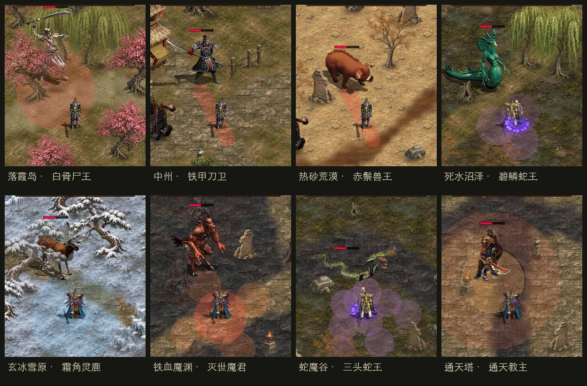

# World of Legend Survivors · Mobile

[中文](README.md) · [Play 1.1](https://xiaosang.cc/woool-survivor-mobile/next/) · [Classic 1.0.10](https://xiaosang.cc/woool-survivor-mobile/) · [GitHub](https://github.com/holynova/woool-survivor-mobile)

Fight through eight ten-minute chapters as a warrior, mage or Taoist. Drag to move, attack automatically, then choose an upgrade. Awaken your main skill at rank five and choose a build after five minutes.



Play a boss encounter at 9:58 with the [Armored Guard](https://xiaosang.cc/woool-survivor-mobile/next/?trial=guard) or the [Tower Lord](https://xiaosang.cc/woool-survivor-mobile/next/?trial=tower). Trials use temporary progress. On first launch the new campaign can import your classic progress. Each edition then saves separately in this browser.

<a href="https://xiaosang.cc/woool-survivor-mobile/next/"></a>

## Run locally

Use Node.js 22.12 or later. Start in the repository root for the classic game or in `next/` for version 1.1.

```sh
npm ci
npm run dev
```

## Test and publish

Both builds live on `main`. Run the following commands from the directory for the edition you want. Its Wrangler configuration selects that edition’s Worker and route.

```sh
npm test
npm run build
npx wrangler@4.128.0 deploy --config wrangler.jsonc
```

[Campaign guide and artwork credits](next/PLAY-GUIDE.md) · [Classic guide](PLAY-GUIDE.md)
