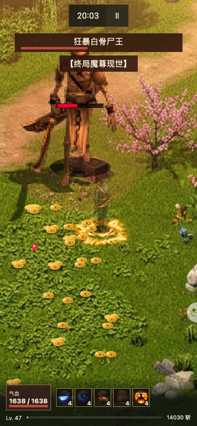

# 传奇世界幸存者 · 移动版

[手机开玩 / Play](https://xiaosang.cc/woool-survivor-mobile/) · [GitHub](https://github.com/holynova/woool-survivor-mobile) · [玩法与操作](PLAY-GUIDE.md)

选择战士、法师或道士，单指拖动，在八章战役中迎战精英，最终首领在 10:00 出场。升级时三选一，主修技能到五级可解锁专属觉醒。战局自动存档，可随时回城再战。

A portrait survival game with three classes, eight chapters and four difficulty settings. Drag to move, draft skills as you level up and defeat each chapter’s boss. Your progress is saved in this browser.




## 本地运行 / Development

Node.js 22.12+

```sh
npm ci
npm run dev
```

## 测试与发布 / Test and deploy

从 main 构建，以独立 Worker 服务作品集子路径。部署需要对应的 Cloudflare 账户权限。

```sh
npm test
npm run build
npx wrangler@4.128.0 deploy --config wrangler.jsonc
```

美术、音频与战斗系统来源见[玩法指南](PLAY-GUIDE.md#来源)。
