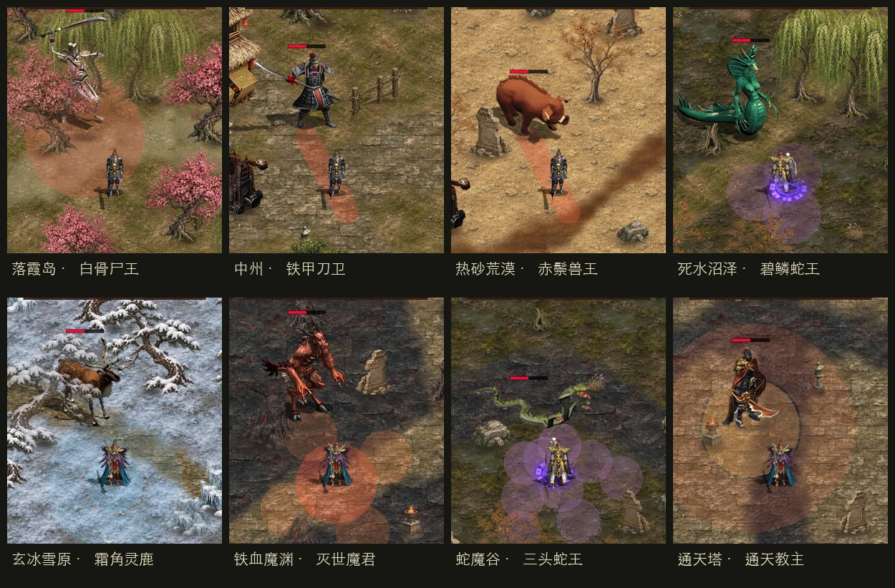

# 传奇世界幸存者 · 移动版

[English](README.en.md) · [玩 1.1 新版](https://xiaosang.cc/woool-survivor-mobile/next/) · [玩 1.0.10 经典版](https://xiaosang.cc/woool-survivor-mobile/) · [GitHub](https://github.com/holynova/woool-survivor-mobile)

选战士、法师或道士，拖动走位、自动出招，在八个十分钟章节里守住战场。升级时三选一，主修技能五级觉醒，五分钟后选择流派。



点[中州屋角 · 铁甲刀卫](https://xiaosang.cc/woool-survivor-mobile/next/?trial=guard)或[通天塔 · 通天教主](https://xiaosang.cc/woool-survivor-mobile/next/?trial=tower)可从 9:58 开始试招。试招单独计进度。首次打开新版可以带入旧存档，之后两个版本在本机分别保存。

<a href="https://xiaosang.cc/woool-survivor-mobile/next/"></a>

## 本地运行

需要 Node.js 22.12 或更新版本。经典版从仓库根目录启动；新版先进入 `next/`。

```sh
npm ci
npm run dev
```

## 测试与发布

两个版本均在 `main`。在对应版本目录运行以下命令，Wrangler 配置会选中该版本的 Worker 和网址。

```sh
npm test
npm run build
npx wrangler@4.128.0 deploy --config wrangler.jsonc
```

[新版玩法与素材来源](next/PLAY-GUIDE.md) · [经典版指南](PLAY-GUIDE.md)
